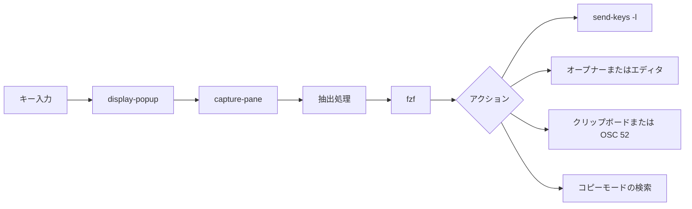

<div align="center">

# tmux-extract-revamped

<strong>画面上の URL、パス、ハッシュなどのトークンを fzf で選び、カーソル位置に入力します。純粋なシェルだけで動きます。</strong>

[English](README.md) &nbsp;|&nbsp; 日本語 &nbsp;|&nbsp; [简体中文](README.zh-Hans.md) &nbsp;|&nbsp; [繁體中文（香港）](README.zh-HK.md)

[](https://github.com/tmux-revamped/tmux-extract-revamped/actions/workflows/tests.yml)
[](LICENSE)
[](CHANGELOG.md)

<p align="center">
  <a href="#できること">できること</a> &nbsp;|&nbsp;
  <a href="#動作要件">動作要件</a> &nbsp;|&nbsp;
  <a href="#インストール">インストール</a> &nbsp;|&nbsp;
  <a href="#使い方">使い方</a> &nbsp;|&nbsp;
  <a href="#設定">設定</a> &nbsp;|&nbsp;
  <a href="#キーバインド">キーバインド</a> &nbsp;|&nbsp;
  <a href="#仕組み">仕組み</a> &nbsp;|&nbsp;
  <a href="#開発">開発</a>
</p>

</div>

**14**種類の抽出モードと、選んだ候補に対する**5**種類のアクションがあります。抽出処理はすべて grep、sed、awk のパイプラインで、Python は使いません。

---

## できること

`prefix + M-x` を押すと fzf のポップアップが開き、現在のペインにある URL、ファイルパス、単語がすべて一覧表示されます。文字を入力して絞り込み、`Enter` を押すと、選んだ候補が元のペインにそのままの文字列として入力されます。

既定では、表示中の画面とその上 200 行のスクロールバックを読み取ります。ウィンドウ内のすべてのペインや、[tmux-logging-revamped](https://github.com/tmux-revamped/tmux-logging-revamped) が書き出した最新のキャプチャを読み取ることもできます。

| モード | 抽出する内容 |
|:-----|:---------|
| `all` | URL、パス、単語の順で、重複を除いたもの |
| `urls` | `http`、`https`、`ftp`、`file` の URL とメールアドレス |
| `paths` | 絶対パス、`~/`、`./`、`../` で始まるパス、相対パス |
| `words` | 空白で区切られたすべてのトークン |
| `lines` | 空でないすべての行、前後の空白を除去 |
| `shas` | 英字を 1 文字以上含む 7 から 40 文字の 16 進オブジェクト名 |
| `ipv4` | 各オクテットが 255 以下のドット区切りアドレス |
| `ipv6` | 完全表記と `::` 省略表記の IPv6 アドレス |
| `color` | CSS の 16 進カラー：`#rgb`、`#rgba`、`#rrggbb`、`#rrggbbaa` |
| `uuid` | 8-4-4-4-12 形式の UUID |
| `numbers` | 符号付きも含む整数と小数 |
| `quoted` | シングルクォート、ダブルクォート、バッククォートで囲まれた文字列 |
| `bracketed` | `()`、`[]`、`{}`、`<>` で囲まれた文字列 |
| `custom` | `@extract_revamped_custom_regex` の拡張正規表現に一致するもの |

URL とパスは、末尾の `.`、`,`、`)`、引用符などの記号を取り除きます。どのモードも重複を除き、各抽出処理は画面に最初に現れた順で一致を並べます。

## 動作要件

| 要件 | バージョンまたは補足 |
|:------------|:----------------|
| tmux | `display-popup` を使うため 3.2 以上 |
| bash | 3.2 以上。macOS の `/bin/bash` でも動きます |
| [fzf](https://github.com/junegunn/fzf) | `PATH` 上に必要です。ない場合、ポップアップは何も選ばずに閉じます |
| オープナー、任意 | URL を開くアクション用の `xdg-open` または `open` |
| クリップボード、任意 | コピーアクション用の `pbcopy`、`wl-copy`、`xclip` |
| `base64`、任意 | OSC 52 でのコピー用 |

CI では、Linux の x86_64 と arm64 で GNU coreutils と uutils coreutils を使い、macOS の Apple Silicon と Intel でシステムの BSD ツール、GNU coreutils、uutils coreutils を使ってテストを実行しています。

## インストール

[TPM](https://github.com/tmux-plugins/tpm) を使う場合は、`~/.tmux.conf` にプラグインを追加して `prefix + I` を押します。

```tmux
set -g @plugin 'tmux-revamped/tmux-extract-revamped'
```

TPM を使わない場合は、リポジトリをクローンし、`~/.tmux.conf` からエントリポイントを実行します。

```sh
git clone https://github.com/tmux-revamped/tmux-extract-revamped ~/.tmux/plugins/tmux-extract-revamped
```

```tmux
run-shell ~/.tmux/plugins/tmux-extract-revamped/extract-revamped.tmux
```

## 使い方

`prefix + M-x` は既定のモードでピッカーを開きます。ほかのアクションは、それぞれにキーを割り当てるまでバインドされません。

```tmux
set -g @extract_revamped_open_key 'M-o'
set -g @extract_revamped_copy_key 'M-y'
set -g @extract_revamped_chooser_key 'M-u'
```

| アクション | 選んだ候補の扱い |
|:-------|:-------------------------|
| insert | 元のペインに入力します。`prefix + M-x` の動作です |
| navigate | 元のペインをコピーモードにし、候補を文字どおりに後方検索します |
| open | URL は `xdg-open` または `open` に渡し、パスは元のペインのディレクトリで開いた新しいウィンドウの `$EDITOR` で開き、それ以外は入力します |
| copy | `pbcopy`、`wl-copy`、`xclip` に渡します。`@extract_revamped_osc52` が `1` のときは OSC 52 シーケンスとして出力します |
| chooser | 1 つのポップアップですべてを行います。`ctrl-n` で `@extract_revamped_modes` の次のモードに切り替え、`ctrl-o` で開き、`ctrl-y` でコピーし、`Enter` で入力します |
| doctor | fzf、オープナー、クリップボードツール、`base64` があるかを表示し、`Enter` を待ちます |

`@extract_revamped_multi` を `1` にした場合と chooser では、`Tab` で複数の候補に印を付けられます。insert は半角スペース 1 つで連結して入力し、copy はすべてをコピーし、open は最初の 1 つを開きます。

## 設定

| オプション | 既定値 | 意味 |
|:-------|:--------|:--------|
| `@extract_revamped_key` | `M-x` | ピッカーを開くキー。空の値では `M-x` のままです |
| `@extract_revamped_navigate_key` | 未設定 | navigate アクションのキー |
| `@extract_revamped_open_key` | 未設定 | open アクションのキー |
| `@extract_revamped_copy_key` | 未設定 | copy アクションのキー |
| `@extract_revamped_chooser_key` | 未設定 | ポップアップ内の chooser のキー |
| `@extract_revamped_doctor_key` | 未設定 | doctor レポートのキー |
| `@extract_revamped_mode` | `all` | すべてのキーが開始するモード。プラグインの読み込み時に読み取ります |
| `@extract_revamped_modes` | `all urls paths words lines` | chooser で `ctrl-n` が順に切り替えるモード |
| `@extract_revamped_scope` | `pane` | 読み取る対象：`pane`、ウィンドウ内の全ペインを表す `all-panes`、`@logging_revamped_path` 内の最新ファイルを表す `last-log` |
| `@extract_revamped_custom_regex` | 未設定 | `custom` モードの拡張正規表現 |
| `@extract_revamped_min_length` | `0` | この文字数より短い候補を除外します |
| `@extract_revamped_reverse` | `0` | `1` で一覧を逆順にし、画面上で最後に一致したものを先頭にします |
| `@extract_revamped_multi` | `0` | `1` で fzf の複数選択を有効にします |
| `@extract_revamped_osc52` | `0` | `1` で copy がクリップボードツールの代わりに OSC 52 を出力します |
| `@extract_revamped_frecency` | `0` | `1` で最近選んだ候補を先頭に移します |
| `@extract_revamped_lines` | `200` | 表示中の画面より上で読み取るスクロールバックの行数 |
| `@extract_revamped_popup_width` | `80%` | ポップアップの幅 |
| `@extract_revamped_popup_height` | `60%` | ポップアップの高さ |

`last-log` は `@logging_revamped_path` を読みます。既定値は `~/.tmux/logging-revamped` です。

### 内部状態

このオプションはプラグインが自身で管理します。設定しないでください。

| オプション | 保持する内容 |
|:-------|:------|
| `@extract_revamped_recent` | 最近選んだ候補を新しい順に最大 20 件、1 行に 1 件。`@extract_revamped_frecency` が `1` の間だけ読み書きします |

## キーバインド

| キー | アクション | 既定 |
|:----|:-------|:--------|
| `prefix + M-x` | ピッカー、insert アクション | バインド済み |
| `@extract_revamped_navigate_key` | ピッカー、navigate アクション | 未バインド |
| `@extract_revamped_open_key` | ピッカー、open アクション | 未バインド |
| `@extract_revamped_copy_key` | ピッカー、copy アクション | 未バインド |
| `@extract_revamped_chooser_key` | chooser ポップアップ | 未バインド |
| `@extract_revamped_doctor_key` | doctor レポート | 未バインド |

`M-x` は、ファミリーのキー割り当てにおけるこのプラグインの枠です。バージョン 2.0.0 で、tmux 3.8 が既定でバインドする `Tab` から移しました。以前のキーを使い続けるには次のようにします。

```tmux
set -g @extract_revamped_key 'Tab'
```

## 仕組み



エントリポイント [`extract-revamped.tmux`](extract-revamped.tmux) は、各キーを `display-popup -E` にバインドし、モード、元のペイン ID、アクションを付けて [`src/extract.sh`](src/extract.sh) を実行します。スクリプトは `capture-pane` でテキストを読み取り、[`src/lib/extract/extract.sh`](src/lib/extract/extract.sh) の抽出処理を実行し、候補を fzf に渡します。insert は `send-keys -l` を使うため、`Enter` や `C-c` のような候補もキー操作ではなく文字として入力されます。プラグインのパスとモードは `printf '%q'` でクォートするため、空白やシングルクォートを含むプラグインディレクトリでも動きます。

## 開発

| コマンド | 実行する内容 |
|:--------|:-------------|
| `make test` | [`test/`](test) 以下の bats テスト |
| `make lint` | すべてのシェルファイルと [`family/bin/`](family/bin) に対する warning レベルの shellcheck |
| `make coverage` | Linux での kcov による行カバレッジ。95% 未満で失敗します |

抽出処理と [`src/lib/extract/dispatch.sh`](src/lib/extract/dispatch.sh) のヘルパーは、テキストを受け取って候補を返す純粋関数です。ペインのキャプチャ、fzf、貼り付けは小さなラッパーの後ろにあるため、ほとんどのテストはペインも fzf も必要としません。

## ライセンス

[MIT](LICENSE)、copyright Gustavo Franco。

<!-- family:begin -->

## tmux-revamped ファミリー

このプラグインは tmux-revamped ファミリーの一員です。すべてのメンバーが [`FAMILY.md`](FAMILY.md) にある同じ規約、`family/` 以下の同じツール、同じ共有ライブラリを持ち、それらはチェックサムのマニフェストでバイト単位まで同一に保たれています。メンバーは一緒にインストールする前提で作られており、ほかのメンバーが使うキーや tmux オプションを使うメンバーはありません。

1 つのメンバーで見つかった不具合は、修正完了とする前にすべてのメンバーで探します。この義務は記憶に頼らず規約に書かれており、`family/bin/sweep` がそれを果たす手段です。

| メンバー | 内容 |
|---|---|
| [`tmux-autoreload-revamped`](https://github.com/tmux-revamped/tmux-autoreload-revamped) | tmuxの設定を編集して保存するだけで、キーもコマンドも使わずに自動で再読み込みされます |
| [`tmux-battery-revamped`](https://github.com/tmux-revamped/tmux-battery-revamped) | tmux のステータスバーにバッテリーの状態を表示し、描画を妨げません |
| [`tmux-bluetooth-revamped`](https://github.com/tmux-revamped/tmux-bluetooth-revamped) | 接続中のすべての Bluetooth デバイスとそのバッテリーを tmux のステータスバーに表示し、描画を妨げません |
| [`tmux-cpu-revamped`](https://github.com/tmux-revamped/tmux-cpu-revamped) | CPU の負荷、温度、周波数を tmux のステータスバーに表示し、描画を妨げません |
| [`tmux-disk-revamped`](https://github.com/tmux-revamped/tmux-disk-revamped) | tmux のステータスバーにディスク使用量を表示し、描画を妨げません |
| [`tmux-extract-revamped`](https://github.com/tmux-revamped/tmux-extract-revamped) | **このプラグイン**、画面上の URL、パス、ハッシュなどのトークンを fzf で選び、カーソル位置に入力します。純粋なシェルだけで動きます |
| [`tmux-fzf-revamped`](https://github.com/tmux-revamped/tmux-fzf-revamped) | ポップアップ内の fzf ピッカーから、tmux のセッション、ウィンドウ、ペインの切り替え、終了、名前変更、作成を行います |
| [`tmux-git-revamped`](https://github.com/tmux-revamped/tmux-git-revamped) | アクティブなペインのgitブランチ、変更、プロバイダーの件数を、描画を止めずにtmuxのステータスバーに表示します |
| [`tmux-gpu-revamped`](https://github.com/tmux-revamped/tmux-gpu-revamped) | NVIDIA、AMD、Intel、Apple の GPU の負荷、温度、クロック、電力、メモリを tmux のステータスバーに表示します |
| [`tmux-kube-revamped`](https://github.com/tmux-revamped/tmux-kube-revamped) | 現在の Kubernetes コンテキストと名前空間を、kubectl を使わずに kubeconfig から解析して tmux のステータスバーに表示します |
| [`tmux-launcher-revamped`](https://github.com/tmux-revamped/tmux-launcher-revamped) | 任意の TUI アプリを、現在のペインのディレクトリでポップアップまたはウィンドウとして起動します。アプリごとにキーを設定できます |
| [`tmux-logging-revamped`](https://github.com/tmux-revamped/tmux-logging-revamped) | 任意のペインをファイルに保存します。ライブのログ記録、スクロールバック全体、1 回限りのスクリーンショットに対応します |
| [`tmux-music-revamped`](https://github.com/tmux-revamped/tmux-music-revamped) | 再生中の曲をステータスバーに表示し、ステータスの描画を止めません |
| [`tmux-network-revamped`](https://github.com/tmux-revamped/tmux-network-revamped) | ネットワークのスループットをステータスバーに表示し、描画を止めません |
| [`tmux-pain-control-revamped`](https://github.com/tmux-revamped/tmux-pain-control-revamped) | tmux の標準的なペインとウィンドウの操作キー。tmux のバージョンに対応し、vim と共存でき、すべて設定できます |
| [`tmux-persist-revamped`](https://github.com/tmux-revamped/tmux-persist-revamped) | tmux のすべてのセッション、ウィンドウ、ペインを保存し、タイマーで自動保存し、再起動後にすべて復元します |
| [`tmux-plugin-template`](https://github.com/tmux-revamped/tmux-plugin-template) | 描画を妨げない tmux ステータスプラグインを作るためのテンプレート |
| [`tmux-pomodoro-revamped`](https://github.com/tmux-revamped/tmux-pomodoro-revamped) | tmux のステータスバーに表示するポモドーロタイマー。状態はすべて tmux オプションに保存し、一時ファイルは使いません |
| [`tmux-ram-revamped`](https://github.com/tmux-revamped/tmux-ram-revamped) | RAM、スワップ、メモリ圧迫を tmux のステータスバーに表示します。取得はバックグラウンドで行うため、描画が待つことはありません |
| [`tmux-reorder-revamped`](https://github.com/tmux-revamped/tmux-reorder-revamped) | tmux のステータスバー上でウィンドウタブをマウスでドラッグして、そのウィンドウを移動します |
| [`tmux-scroll-revamped`](https://github.com/tmux-revamped/tmux-scroll-revamped) | 自分でスクロールするアプリにはマウスホイールをそのまま送り、それ以外では tmux のコピーモードに入ります |
| [`tmux-sensible-revamped`](https://github.com/tmux-revamped/tmux-sensible-revamped) | tmux のバージョンと端末に応じて適用する実用的な既定値。自分で設定したオプションには手を触れません |
| [`tmux-tiling-revamped`](https://github.com/tmux-revamped/tmux-tiling-revamped) | tmux 用の BSP タイリングウィンドウ管理。8 種類のレイアウト、19 種類の操作、依存関係なし |
| [`tmux-time-revamped`](https://github.com/tmux-revamped/tmux-time-revamped) | tmux のステータスバー用の現地時計と世界時計。時間帯で色分けし、カウントダウンと夏時間の警告もあります |
| [`tmux-weather-revamped`](https://github.com/tmux-revamped/tmux-weather-revamped) | wttr.in の天気を tmux のステータスバーに表示します。取得はバックグラウンドで行うため、ステータスラインが待つことはありません |

### インストールの確認

すべてのメンバーがディスク上にあれば、1 つのコマンドでメンバー間の衝突を報告します。

```sh
family/bin/doctor --live
```

各メンバーと実行中の tmux サーバーを読み取り、重複したキー、重複したステータスのプレースホルダー、命名規則に従わないオプション、規約バージョンが古くなったメンバーを報告します。

<!-- family:end -->
