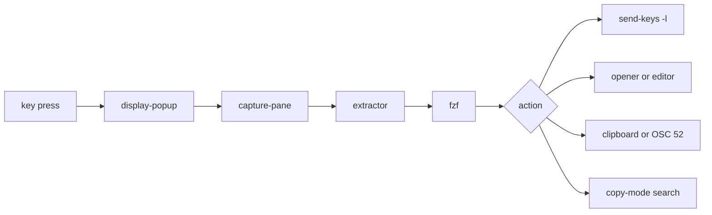

<div align="center">

# tmux-extract-revamped

<strong>Pick a URL, path, hash or any other token off the screen with fzf and type it at the cursor, in pure shell.</strong>

English | [日本語](README.ja.md) | [简体中文](README.zh-Hans.md) | [繁體中文（香港）](README.zh-HK.md)

[](https://github.com/tmux-revamped/tmux-extract-revamped/actions/workflows/family.yml)
[](https://github.com/tmux-revamped/tmux-extract-revamped/actions/workflows/tests.yml)
[](https://github.com/tmux-revamped/tmux-extract-revamped/releases/latest)
[](https://scorecard.dev/viewer/?uri=github.com/tmux-revamped/tmux-extract-revamped)
[](LICENSE)

<p align="center">
  <a href="#what-it-does">What it does</a> |
  <a href="#requirements">Requirements</a> |
  <a href="#installation">Installation</a> |
  <a href="#usage">Usage</a> |
  <a href="#configuration">Configuration</a> |
  <a href="#key-bindings">Key bindings</a> |
  <a href="#how-it-works">How it works</a> |
  <a href="#development">Development</a>
</p>

</div>

**14** extraction modes, **5** actions on a pick, and every extractor is a grep, sed or awk pipeline with no Python.

---

## What it does

Press `prefix + M-x` and an fzf popup lists every URL, file path and word in the current pane. Type to filter, press `Enter`, and the pick is typed into the pane you came from as literal text.

The picker reads the visible screen plus 200 lines of scrollback by default. It can also read every pane in the window, or the newest capture written by [tmux-logging-revamped](https://github.com/tmux-revamped/tmux-logging-revamped).

| Mode | Extracts |
|:-----|:---------|
| `all` | URLs, then paths, then words, with duplicates removed |
| `urls` | `http`, `https`, `ftp` and `file` URLs, and email addresses |
| `paths` | absolute, `~/`, `./`, `../` and relative paths |
| `words` | every whitespace-separated token |
| `lines` | every non-blank line, trimmed |
| `shas` | hex object names of 7 to 40 characters that contain at least one letter |
| `ipv4` | dotted-quad addresses with every octet at most 255 |
| `ipv6` | full and `::`-compressed IPv6 addresses |
| `color` | CSS hex colors: `#rgb`, `#rgba`, `#rrggbb`, `#rrggbbaa` |
| `uuid` | canonical 8-4-4-4-12 UUIDs |
| `numbers` | integers and decimals with an optional sign |
| `quoted` | the text inside single quotes, double quotes or backticks |
| `bracketed` | the text inside `()`, `[]`, `{}` or `<>` |
| `custom` | matches of the extended regex in `@extract_revamped_custom_regex` |

URLs and paths lose trailing punctuation such as `.`, `,`, `)` and quotes. Every mode drops duplicates, and each extractor lists its matches in the order they first appear on screen.

## Requirements

| Requirement | Version or note |
|:------------|:----------------|
| tmux | 3.2 or later, for `display-popup` |
| bash | 3.2 or later, so the macOS `/bin/bash` works |
| [fzf](https://github.com/junegunn/fzf) | on `PATH`; without it the popup closes with nothing picked |
| Opener, optional | `xdg-open` or `open`, for the open action on a URL |
| Clipboard, optional | `pbcopy`, `wl-copy` or `xclip`, for the copy action |
| `base64`, optional | for the copy action over OSC 52 |

CI runs the suite on Linux x86_64 and arm64 with GNU and uutils coreutils, and on macOS Apple Silicon and Intel with the system BSD tools, GNU coreutils and uutils coreutils.

## Installation

With [TPM](https://github.com/tmux-plugins/tpm), add the plugin to `~/.tmux.conf` and press `prefix + I`:

```tmux
set -g @plugin 'tmux-revamped/tmux-extract-revamped'
```

Without TPM, clone the repository and run the entrypoint from `~/.tmux.conf`:

```sh
git clone https://github.com/tmux-revamped/tmux-extract-revamped ~/.tmux/plugins/tmux-extract-revamped
```

```tmux
run-shell ~/.tmux/plugins/tmux-extract-revamped/extract-revamped.tmux
```

## Usage

`prefix + M-x` opens the picker in the default mode. The other actions stay unbound until you give each one a key:

```tmux
set -g @extract_revamped_open_key 'M-o'
set -g @extract_revamped_copy_key 'M-y'
set -g @extract_revamped_chooser_key 'M-u'
```

| Action | What happens to the pick |
|:-------|:-------------------------|
| insert | typed into the source pane; this is what `prefix + M-x` does |
| navigate | the source pane enters copy-mode and searches backward for the pick, matched literally |
| open | a URL goes to `xdg-open` or `open`, a path opens in `$EDITOR` in a new window started in the source pane's directory, anything else is typed |
| copy | goes to `pbcopy`, `wl-copy` or `xclip`, or out as an OSC 52 sequence when `@extract_revamped_osc52` is `1` |
| chooser | one popup for all of them: `ctrl-n` switches to the next mode in `@extract_revamped_modes`, `ctrl-o` opens, `ctrl-y` copies, `Enter` inserts |
| doctor | prints whether fzf, an opener, a clipboard tool and `base64` are present, and waits for `Enter` |

With `@extract_revamped_multi` set to `1`, and always in the chooser, `Tab` marks several candidates. Insert types them joined by single spaces, copy copies all of them, and open acts on the first one.

## Configuration

| Option | Default | Meaning |
|:-------|:--------|:--------|
| `@extract_revamped_key` | `M-x` | key that opens the picker; an empty value keeps `M-x` |
| `@extract_revamped_navigate_key` | unset | key for the navigate action |
| `@extract_revamped_open_key` | unset | key for the open action |
| `@extract_revamped_copy_key` | unset | key for the copy action |
| `@extract_revamped_chooser_key` | unset | key for the in-popup chooser |
| `@extract_revamped_doctor_key` | unset | key for the doctor report |
| `@extract_revamped_mode` | `all` | mode every key starts in, read when the plugin loads |
| `@extract_revamped_modes` | `all urls paths words lines` | modes `ctrl-n` cycles through in the chooser |
| `@extract_revamped_scope` | `pane` | text to read: `pane`, `all-panes` for every pane in the window, or `last-log` for the newest file in `@logging_revamped_path` |
| `@extract_revamped_custom_regex` | unset | extended regex for the `custom` mode |
| `@extract_revamped_min_length` | `0` | drop candidates shorter than this many characters |
| `@extract_revamped_reverse` | `0` | `1` reverses the list so the last match on screen comes first |
| `@extract_revamped_multi` | `0` | `1` lets fzf mark several candidates |
| `@extract_revamped_osc52` | `0` | `1` makes copy emit OSC 52 instead of calling a clipboard tool |
| `@extract_revamped_frecency` | `0` | `1` moves recently picked candidates to the top |
| `@extract_revamped_lines` | `200` | lines of scrollback read above the visible screen |
| `@extract_revamped_popup_width` | `80%` | popup width |
| `@extract_revamped_popup_height` | `60%` | popup height |

`last-log` reads `@logging_revamped_path`, which defaults to `~/.tmux/logging-revamped`.

### Internal state

The plugin manages this option itself. Do not set it.

| Option | Holds |
|:-------|:------|
| `@extract_revamped_recent` | up to 20 recent picks, newest first, one per line, written and read only while `@extract_revamped_frecency` is `1` |

## Key bindings

| Key | Action | Default |
|:----|:-------|:--------|
| `prefix + M-x` | picker, insert action | bound |
| `@extract_revamped_navigate_key` | picker, navigate action | unbound |
| `@extract_revamped_open_key` | picker, open action | unbound |
| `@extract_revamped_copy_key` | picker, copy action | unbound |
| `@extract_revamped_chooser_key` | chooser popup | unbound |
| `@extract_revamped_doctor_key` | doctor report | unbound |

`M-x` is this plugin's slot in the family key allocation. Version 2.0.0 moved it from `Tab`, which tmux 3.8 binds by default. To keep the old key:

```tmux
set -g @extract_revamped_key 'Tab'
```

## How it works



The entrypoint [`extract-revamped.tmux`](extract-revamped.tmux) binds each key to `display-popup -E` running [`src/extract.sh`](src/extract.sh) with the mode, the source pane id and the action. The script reads the text with `capture-pane`, runs the extractor from [`src/lib/extract/extract.sh`](src/lib/extract/extract.sh), and pipes the candidates into fzf. Insert uses `send-keys -l`, so a pick such as `Enter` or `C-c` is typed as text rather than pressed. The plugin path and mode are quoted with `printf '%q'`, so a plugin directory with a space or a single quote still works.

## Development

| Command | What it runs |
|:--------|:-------------|
| `make test` | the bats suite under [`test/`](test) |
| `make lint` | shellcheck at warning severity on every shell file and [`family/bin/`](family/bin) |
| `make coverage` | kcov line coverage on Linux, failing below 95% |

The extractors and the helpers in [`src/lib/extract/dispatch.sh`](src/lib/extract/dispatch.sh) are pure functions, text in and candidates out. The pane capture, fzf and the paste sit behind small wrappers, so most tests need no pane and no fzf.

## License

[MIT](LICENSE), copyright Gustavo Franco.

<!-- family:begin -->

## The tmux-revamped family

This plugin is one member of the tmux-revamped family. Every member carries the
same contract in [`FAMILY.md`](FAMILY.md), the same tooling under `family/`, and
the same shared library, all held byte-identical by a checksum manifest. They are
built to be installed together: no member claims a key or a tmux option that
another member claims.

A defect found in one member is hunted across all of them before the fix is
called done. That obligation is written into the contract rather than left to
memory, and `family/bin/sweep` is how it is discharged.

| Member | What it does |
|---|---|
| [`tmux-autoreload-revamped`](https://github.com/tmux-revamped/tmux-autoreload-revamped) | Edit your tmux config, save, and watch it reload itself, no key, no command |
| [`tmux-battery-revamped`](https://github.com/tmux-revamped/tmux-battery-revamped) | Battery status for your tmux status bar, without ever blocking the status render |
| [`tmux-bluetooth-revamped`](https://github.com/tmux-revamped/tmux-bluetooth-revamped) | Every connected Bluetooth device and its battery in your tmux status bar, without blocking the render |
| [`tmux-cpu-revamped`](https://github.com/tmux-revamped/tmux-cpu-revamped) | CPU load, temperature, and frequency in your tmux status bar, without ever blocking the render |
| [`tmux-disk-revamped`](https://github.com/tmux-revamped/tmux-disk-revamped) | Disk usage for your tmux status bar, without ever blocking the status render |
| [`tmux-extract-revamped`](https://github.com/tmux-revamped/tmux-extract-revamped) | **this plugin**, Pick a URL, path, hash or any other token off the screen with fzf and type it at the cursor, in pure shell |
| [`tmux-fzf-revamped`](https://github.com/tmux-revamped/tmux-fzf-revamped) | Switch to, kill, rename or create tmux sessions, windows and panes from fzf pickers in a popup |
| [`tmux-git-revamped`](https://github.com/tmux-revamped/tmux-git-revamped) | Show the active pane's git branch, changes and provider counts in the tmux status bar without blocking it |
| [`tmux-gpu-revamped`](https://github.com/tmux-revamped/tmux-gpu-revamped) | GPU load, temperature, clock, power and memory in the tmux status bar, from NVIDIA, AMD, Intel and Apple GPUs |
| [`tmux-kube-revamped`](https://github.com/tmux-revamped/tmux-kube-revamped) | Current Kubernetes context and namespace in the tmux status bar, parsed from kubeconfig without kubectl |
| [`tmux-launcher-revamped`](https://github.com/tmux-revamped/tmux-launcher-revamped) | Launch any TUI app in a popup or a window, scoped to the current pane's directory, with one configurable bindi |
| [`tmux-logging-revamped`](https://github.com/tmux-revamped/tmux-logging-revamped) | Capture any pane to a file: live logging, full scrollback, or a one-shot screenshot |
| [`tmux-music-revamped`](https://github.com/tmux-revamped/tmux-music-revamped) | Now playing in your tmux status bar, without ever blocking the status render |
| [`tmux-network-revamped`](https://github.com/tmux-revamped/tmux-network-revamped) | Network throughput in your tmux status bar, without ever blocking the render |
| [`tmux-pain-control-revamped`](https://github.com/tmux-revamped/tmux-pain-control-revamped) | Pane and window management bindings for tmux, version aware, vim friendly, every prefix key can be disabled |
| [`tmux-persist-revamped`](https://github.com/tmux-revamped/tmux-persist-revamped) | Save every tmux session, window and pane, auto-save on a timer, and restore it all after a reboot |
| [`tmux-plugin-template`](https://github.com/tmux-revamped/tmux-plugin-template) | The starting point for a tmux-revamped plugin: shared library, bats harness, CI and family tooling |
| [`tmux-pomodoro-revamped`](https://github.com/tmux-revamped/tmux-pomodoro-revamped) | A Pomodoro timer in the tmux status bar that keeps all of its state in tmux options, with no temp files |
| [`tmux-ram-revamped`](https://github.com/tmux-revamped/tmux-ram-revamped) | RAM, swap and memory pressure in the tmux status bar, sampled in the background so the render never waits |
| [`tmux-reorder-revamped`](https://github.com/tmux-revamped/tmux-reorder-revamped) | Drag a window tab along the tmux status bar with the mouse to move that window |
| [`tmux-scroll-revamped`](https://github.com/tmux-revamped/tmux-scroll-revamped) | Send the mouse wheel to apps that scroll themselves and into tmux copy-mode everywhere else |
| [`tmux-sensible-revamped`](https://github.com/tmux-revamped/tmux-sensible-revamped) | Sensible tmux defaults, gated by tmux version and terminal, that leave the options you set alone |
| [`tmux-tiling-revamped`](https://github.com/tmux-revamped/tmux-tiling-revamped) | Tiling window management for tmux: eight layouts including BSP dwindle and spiral, with layout undo |
| [`tmux-time-revamped`](https://github.com/tmux-revamped/tmux-time-revamped) | Local and world clocks for the tmux status bar, colored by time of day, with countdowns and a DST warning |
| [`tmux-weather-revamped`](https://github.com/tmux-revamped/tmux-weather-revamped) | Weather for the tmux status bar from wttr.in, fetched in the background so the status line never waits |

### Checking an installation

With every member on disk, one command reports any conflict between them:

```sh
family/bin/doctor --live
```

It reads each member and the running tmux server, and reports duplicate keys,
duplicate status placeholders, options outside the naming grammar, and any
member whose contract version has fallen behind.

<!-- family:end -->
