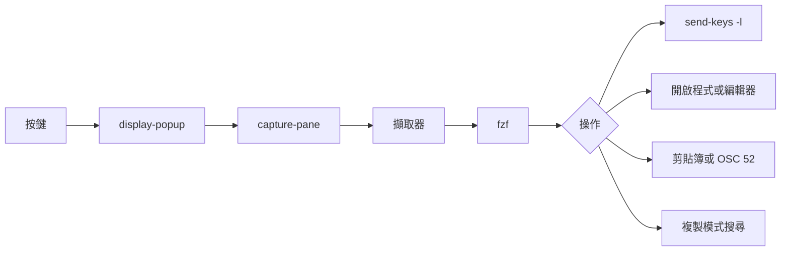

<div align="center">

# tmux-extract-revamped

<strong>用 fzf 從畫面上揀選 URL、路徑、雜湊值或任何其他字詞，並輸入到游標位置，全部以純 shell 實現。</strong>

[English](README.md) | [日本語](README.ja.md) | [简体中文](README.zh-Hans.md) | 繁體中文（香港）

[](https://github.com/tmux-revamped/tmux-extract-revamped/actions/workflows/family.yml)
[](https://github.com/tmux-revamped/tmux-extract-revamped/actions/workflows/tests.yml)
[](https://github.com/tmux-revamped/tmux-extract-revamped/releases/latest)
[](https://scorecard.dev/viewer/?uri=github.com/tmux-revamped/tmux-extract-revamped)
[](LICENSE)

<p align="center">
  <a href="#功能">功能</a> |
  <a href="#系統要求">系統要求</a> |
  <a href="#安裝">安裝</a> |
  <a href="#用法">用法</a> |
  <a href="#設定">設定</a> |
  <a href="#按鍵綁定">按鍵綁定</a> |
  <a href="#運作原理">運作原理</a> |
  <a href="#開發">開發</a>
</p>

</div>

**14** 種擷取模式，對選中項目有 **5** 種操作，每個擷取器都是 grep、sed 或 awk 管線，不需要 Python。

---

## 功能

按下 `prefix + M-x`，fzf 彈出視窗會列出目前窗格中所有 URL、檔案路徑和字詞。輸入文字篩選，按 `Enter`，選中項目便會以字面文字輸入到你原來的窗格。

預設讀取可見畫面及其上方 200 行回捲內容。亦可讀取視窗內所有窗格，或讀取 [tmux-logging-revamped](https://github.com/tmux-revamped/tmux-logging-revamped) 寫出的最新擷取檔案。

| 模式 | 擷取內容 |
|:-----|:---------|
| `all` | 依次為 URL、路徑、字詞，並移除重複項目 |
| `urls` | `http`、`https`、`ftp` 和 `file` URL，以及電郵地址 |
| `paths` | 絕對路徑、以 `~/`、`./`、`../` 開頭的路徑及相對路徑 |
| `words` | 每個以空白分隔的字詞 |
| `lines` | 每個非空行，並移除前後空白 |
| `shas` | 長度為 7 至 40 個字元、最少包含一個字母的十六進制物件名稱 |
| `ipv4` | 每個八位元組都不大於 255 的點分十進制地址 |
| `ipv6` | 完整形式及 `::` 壓縮形式的 IPv6 地址 |
| `color` | CSS 十六進制顏色：`#rgb`、`#rgba`、`#rrggbb`、`#rrggbbaa` |
| `uuid` | 標準 8-4-4-4-12 格式的 UUID |
| `numbers` | 可帶正負號的整數及小數 |
| `quoted` | 單引號、雙引號或反引號內的文字 |
| `bracketed` | `()`、`[]`、`{}` 或 `<>` 內的文字 |
| `custom` | 符合 `@extract_revamped_custom_regex` 中擴展正規表示式的內容 |

URL 和路徑會移除結尾的 `.`、`,`、`)` 及引號等標點。每種模式都會移除重複項目，每個擷取器按配對項目在畫面上首次出現的次序列出。

## 系統要求

| 要求 | 版本或說明 |
|:------------|:----------------|
| tmux | 3.2 或以上，因為需要 `display-popup` |
| bash | 3.2 或以上，macOS 內置的 `/bin/bash` 亦可使用 |
| [fzf](https://github.com/junegunn/fzf) | 必須在 `PATH` 之中；沒有的話，彈出視窗會直接關閉，不揀選任何內容 |
| 開啟程式，可選 | `xdg-open` 或 `open`，用於開啟 URL |
| 剪貼簿，可選 | `pbcopy`、`wl-copy` 或 `xclip`，用於複製操作 |
| `base64`，可選 | 用於透過 OSC 52 複製 |

CI 在 Linux x86_64 及 arm64 上以 GNU 和 uutils coreutils 執行測試，並在 macOS Apple Silicon 及 Intel 上以系統內置的 BSD 工具、GNU coreutils 和 uutils coreutils 執行測試。

## 安裝

使用 [TPM](https://github.com/tmux-plugins/tpm) 時，將插件加入 `~/.tmux.conf`，然後按 `prefix + I`：

```tmux
set -g @plugin 'tmux-revamped/tmux-extract-revamped'
```

不使用 TPM 時，複製儲存庫，並在 `~/.tmux.conf` 中執行入口腳本：

```sh
git clone https://github.com/tmux-revamped/tmux-extract-revamped ~/.tmux/plugins/tmux-extract-revamped
```

```tmux
run-shell ~/.tmux/plugins/tmux-extract-revamped/extract-revamped.tmux
```

## 用法

`prefix + M-x` 以預設模式開啟揀選器。其他操作在你為其指定按鍵之前都不會綁定：

```tmux
set -g @extract_revamped_open_key 'M-o'
set -g @extract_revamped_copy_key 'M-y'
set -g @extract_revamped_chooser_key 'M-u'
```

| 操作 | 對選中項目的處理 |
|:-------|:-------------------------|
| insert | 輸入到來源窗格；`prefix + M-x` 執行的正是這個操作 |
| navigate | 來源窗格進入複製模式，並按字面向後搜尋選中項目 |
| open | URL 交給 `xdg-open` 或 `open`，路徑在新視窗的 `$EDITOR` 中開啟，新視窗由來源窗格的目錄啟動，其他內容則直接輸入 |
| copy | 交給 `pbcopy`、`wl-copy` 或 `xclip`；當 `@extract_revamped_osc52` 為 `1` 時輸出 OSC 52 序列 |
| chooser | 在一個彈出視窗中完成所有操作：`ctrl-n` 切換到 `@extract_revamped_modes` 中的下一個模式，`ctrl-o` 開啟，`ctrl-y` 複製，`Enter` 輸入 |
| doctor | 顯示是否有 fzf、開啟程式、剪貼簿工具及 `base64`，然後等待 `Enter` |

當 `@extract_revamped_multi` 設為 `1` 時，以及在 chooser 之中，可用 `Tab` 標記多個候選項目。insert 以單一空格連接後輸入，copy 複製全部，open 只處理第一個。

## 設定

| 選項 | 預設值 | 意思 |
|:-------|:--------|:--------|
| `@extract_revamped_key` | `M-x` | 開啟揀選器的按鍵；設為空值時仍為 `M-x` |
| `@extract_revamped_navigate_key` | 未設定 | navigate 操作的按鍵 |
| `@extract_revamped_open_key` | 未設定 | open 操作的按鍵 |
| `@extract_revamped_copy_key` | 未設定 | copy 操作的按鍵 |
| `@extract_revamped_chooser_key` | 未設定 | 彈出視窗內 chooser 的按鍵 |
| `@extract_revamped_doctor_key` | 未設定 | doctor 報告的按鍵 |
| `@extract_revamped_mode` | `all` | 所有按鍵啟動時使用的模式，於插件載入時讀取 |
| `@extract_revamped_modes` | `all urls paths words lines` | chooser 中 `ctrl-n` 循環切換的模式 |
| `@extract_revamped_scope` | `pane` | 讀取的文字：`pane`；`all-panes` 代表視窗內所有窗格；`last-log` 代表 `@logging_revamped_path` 中最新的檔案 |
| `@extract_revamped_custom_regex` | 未設定 | `custom` 模式使用的擴展正規表示式 |
| `@extract_revamped_min_length` | `0` | 捨棄短於此字元數的候選項目 |
| `@extract_revamped_reverse` | `0` | 設為 `1` 時反轉列表，令畫面上最後一個配對排在最前 |
| `@extract_revamped_multi` | `0` | 設為 `1` 時容許在 fzf 中標記多個候選項目 |
| `@extract_revamped_osc52` | `0` | 設為 `1` 時 copy 輸出 OSC 52，而不呼叫剪貼簿工具 |
| `@extract_revamped_frecency` | `0` | 設為 `1` 時將最近揀選過的候選項目移到最前 |
| `@extract_revamped_lines` | `200` | 在可見畫面上方讀取的回捲行數 |
| `@extract_revamped_popup_width` | `80%` | 彈出視窗闊度 |
| `@extract_revamped_popup_height` | `60%` | 彈出視窗高度 |

`last-log` 讀取 `@logging_revamped_path`，其預設值為 `~/.tmux/logging-revamped`。

### 內部狀態

此選項由插件自行管理，請勿設定。

| 選項 | 儲存內容 |
|:-------|:------|
| `@extract_revamped_recent` | 最多 20 項最近揀選的項目，最新的排先，每行一項；只在 `@extract_revamped_frecency` 為 `1` 時讀寫 |

## 按鍵綁定

| 按鍵 | 操作 | 預設 |
|:----|:-------|:--------|
| `prefix + M-x` | 揀選器，insert 操作 | 已綁定 |
| `@extract_revamped_navigate_key` | 揀選器，navigate 操作 | 未綁定 |
| `@extract_revamped_open_key` | 揀選器，open 操作 | 未綁定 |
| `@extract_revamped_copy_key` | 揀選器，copy 操作 | 未綁定 |
| `@extract_revamped_chooser_key` | chooser 彈出視窗 | 未綁定 |
| `@extract_revamped_doctor_key` | doctor 報告 | 未綁定 |

`M-x` 是本插件在插件家族按鍵分配中的位置。2.0.0 版把它由 `Tab` 移過來，因為 tmux 3.8 預設綁定了 `Tab`。如要保留舊按鍵：

```tmux
set -g @extract_revamped_key 'Tab'
```

## 運作原理



入口腳本 [`extract-revamped.tmux`](extract-revamped.tmux) 把每個按鍵綁定到 `display-popup -E`，並以模式、來源窗格 ID 和操作為參數執行 [`src/extract.sh`](src/extract.sh)。該腳本以 `capture-pane` 讀取文字，執行 [`src/lib/extract/extract.sh`](src/lib/extract/extract.sh) 中的擷取器，再把候選項目傳給 fzf。insert 使用 `send-keys -l`，所以像 `Enter` 或 `C-c` 這類選中項目會以文字輸入，而不會當作按鍵觸發。插件路徑和模式都經 `printf '%q'` 轉義，因此插件目錄含空格或單引號時亦能正常運作。

## 開發

| 指令 | 執行內容 |
|:--------|:-------------|
| `make test` | [`test/`](test) 下的 bats 測試 |
| `make lint` | 對所有 shell 檔案及 [`family/bin/`](family/bin) 執行 warning 級別的 shellcheck |
| `make coverage` | 在 Linux 上以 kcov 計算行覆蓋率，低於 95% 時失敗 |

擷取器及 [`src/lib/extract/dispatch.sh`](src/lib/extract/dispatch.sh) 中的輔助函數都是純函數，輸入文字，輸出候選項目。窗格擷取、fzf 和貼上都包裝在細小的包裝函數之後，因此大部分測試既不需要窗格，也不需要 fzf。

## 授權

[MIT](LICENSE)，copyright Gustavo Franco。

<!-- family:begin -->

## tmux-revamped 插件家族

本插件是 tmux-revamped 插件家族的成員。每個成員都帶有 [`FAMILY.md`](FAMILY.md) 中的同一份約定、`family/` 下的同一套工具和同一個共用程式庫，並由校驗和清單確保逐位元組一致。這些成員可以一併安裝：任何成員都不會佔用其他成員使用的按鍵或 tmux 選項。

在一個成員中發現的缺陷，要在全部成員中排查後才算修正完成。這項責任寫在約定之中，而不是依靠記憶，`family/bin/sweep` 負責執行。

| 成員 | 功能 |
|---|---|
| [`tmux-autoreload-revamped`](https://github.com/tmux-revamped/tmux-autoreload-revamped) | 編輯並儲存 tmux 設定後，它會自動重新載入，毋須按鍵，也毋須指令 |
| [`tmux-battery-revamped`](https://github.com/tmux-revamped/tmux-battery-revamped) | 在 tmux 狀態列顯示電池狀態，從不阻塞狀態列繪製 |
| [`tmux-bluetooth-revamped`](https://github.com/tmux-revamped/tmux-bluetooth-revamped) | 在 tmux 狀態列顯示每部已連接的藍牙裝置及其電量，不阻塞繪製 |
| [`tmux-cpu-revamped`](https://github.com/tmux-revamped/tmux-cpu-revamped) | 在 tmux 狀態列顯示 CPU 負載、溫度及頻率，從不阻塞繪製 |
| [`tmux-disk-revamped`](https://github.com/tmux-revamped/tmux-disk-revamped) | 在 tmux 狀態列顯示磁碟用量，從不阻塞狀態列繪製 |
| [`tmux-extract-revamped`](https://github.com/tmux-revamped/tmux-extract-revamped) | **本插件**，用 fzf 從畫面上揀選 URL、路徑、雜湊值或任何其他字詞，並輸入到游標位置，全部以純 shell 實現 |
| [`tmux-fzf-revamped`](https://github.com/tmux-revamped/tmux-fzf-revamped) | 在彈出視窗的 fzf 選擇器中切換、關閉、重新命名或建立 tmux 工作階段、視窗和窗格 |
| [`tmux-git-revamped`](https://github.com/tmux-revamped/tmux-git-revamped) | 在 tmux 狀態列顯示當前窗格的 git 分支、改動和託管平台數目，而不會阻塞顯示 |
| [`tmux-gpu-revamped`](https://github.com/tmux-revamped/tmux-gpu-revamped) | 在 tmux 狀態列顯示 NVIDIA、AMD、Intel 及 Apple GPU 的負載、溫度、時脈、功耗及記憶體 |
| [`tmux-kube-revamped`](https://github.com/tmux-revamped/tmux-kube-revamped) | 在 tmux 狀態列顯示目前的 Kubernetes 上下文及命名空間，毋須 kubectl，直接解析 kubeconfig |
| [`tmux-launcher-revamped`](https://github.com/tmux-revamped/tmux-launcher-revamped) | 在彈出視窗或新視窗中啟動任何 TUI 應用程式，從目前窗格的目錄開始，每個應用程式可設定一個按鍵 |
| [`tmux-logging-revamped`](https://github.com/tmux-revamped/tmux-logging-revamped) | 將任何窗格儲存到檔案：即時記錄、完整捲動緩衝區或一次性截圖 |
| [`tmux-music-revamped`](https://github.com/tmux-revamped/tmux-music-revamped) | 在 tmux 狀態列顯示正在播放的歌曲，從不阻塞狀態列的繪製 |
| [`tmux-network-revamped`](https://github.com/tmux-revamped/tmux-network-revamped) | 在 tmux 狀態列顯示網絡傳輸量，從不阻塞繪製 |
| [`tmux-pain-control-revamped`](https://github.com/tmux-revamped/tmux-pain-control-revamped) | tmux 的窗格和視窗管理按鍵，配合 tmux 版本，與 vim 相容，每個 prefix 按鍵都可停用 |
| [`tmux-persist-revamped`](https://github.com/tmux-revamped/tmux-persist-revamped) | 儲存 tmux 的所有工作階段、視窗及窗格，按計時器自動儲存，並在重新開機後全部還原 |
| [`tmux-plugin-template`](https://github.com/tmux-revamped/tmux-plugin-template) | tmux-revamped 插件的起點：共用程式庫、bats 測試框架、CI 和系列工具 |
| [`tmux-pomodoro-revamped`](https://github.com/tmux-revamped/tmux-pomodoro-revamped) | tmux 狀態列中的番茄鐘計時器，所有狀態都儲存在 tmux 選項中，不使用暫存檔 |
| [`tmux-ram-revamped`](https://github.com/tmux-revamped/tmux-ram-revamped) | 在 tmux 狀態列顯示記憶體、交換空間及記憶體壓力，在背景取樣，繪製從不等待 |
| [`tmux-reorder-revamped`](https://github.com/tmux-revamped/tmux-reorder-revamped) | 用滑鼠在 tmux 狀態列上拖動視窗標籤來移動該視窗 |
| [`tmux-scroll-revamped`](https://github.com/tmux-revamped/tmux-scroll-revamped) | 將滑鼠滾輪交給能自行捲動的應用程式，其他情況下進入 tmux 複製模式 |
| [`tmux-sensible-revamped`](https://github.com/tmux-revamped/tmux-sensible-revamped) | 按 tmux 版本和終端機區分的合理預設設定，不會改動你自己設定的選項 |
| [`tmux-tiling-revamped`](https://github.com/tmux-revamped/tmux-tiling-revamped) | tmux 的平鋪視窗管理：八種版面，包括 BSP dwindle 和 spiral，並支援復原版面 |
| [`tmux-time-revamped`](https://github.com/tmux-revamped/tmux-time-revamped) | 狀態列中的本地時鐘和世界時鐘，按一天中的時段著色，並提供倒數和夏令時間提示 |
| [`tmux-weather-revamped`](https://github.com/tmux-revamped/tmux-weather-revamped) | 在背景從 wttr.in 取得天氣並顯示在狀態列，狀態列毋須等待 |

### 檢查安裝

所有成員都在磁碟上時，一個指令即可報告它們之間的任何衝突：

```sh
family/bin/doctor --live
```

它讀取每個成員和正在運行的 tmux 伺服器，報告重複的按鍵、重複的狀態佔位符、不符合命名規則的選項，以及約定版本落後的成員。

<!-- family:end -->
