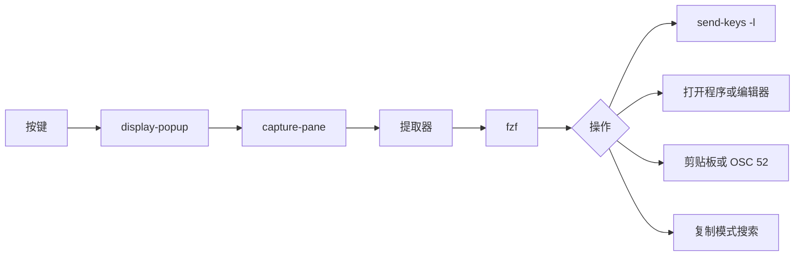

<div align="center">

# tmux-extract-revamped

<strong>用 fzf 从屏幕上挑选 URL、路径、哈希或任意其他词元，并输入到光标处，全部用纯 shell 实现。</strong>

[English](README.md) &nbsp;|&nbsp; [日本語](README.ja.md) &nbsp;|&nbsp; 简体中文 &nbsp;|&nbsp; [繁體中文（香港）](README.zh-HK.md)

[](https://github.com/tmux-revamped/tmux-extract-revamped/actions/workflows/tests.yml)
[](LICENSE)
[](CHANGELOG.md)

<p align="center">
  <a href="#功能">功能</a> &nbsp;|&nbsp;
  <a href="#环境要求">环境要求</a> &nbsp;|&nbsp;
  <a href="#安装">安装</a> &nbsp;|&nbsp;
  <a href="#用法">用法</a> &nbsp;|&nbsp;
  <a href="#配置">配置</a> &nbsp;|&nbsp;
  <a href="#按键绑定">按键绑定</a> &nbsp;|&nbsp;
  <a href="#工作原理">工作原理</a> &nbsp;|&nbsp;
  <a href="#开发">开发</a>
</p>

</div>

**14** 种提取模式，对选中项有 **5** 种操作，每个提取器都是 grep、sed 或 awk 管道，不依赖 Python。

---

## 功能

按下 `prefix + M-x`，fzf 弹窗会列出当前窗格中的所有 URL、文件路径和单词。输入文字进行筛选，按 `Enter`，选中项会作为字面文本输入到你来自的窗格。

默认读取可见屏幕以及其上方 200 行回滚内容。也可以读取窗口中的所有窗格，或读取 [tmux-logging-revamped](https://github.com/tmux-revamped/tmux-logging-revamped) 写出的最新捕获文件。

| 模式 | 提取内容 |
|:-----|:---------|
| `all` | 依次为 URL、路径、单词，并去除重复 |
| `urls` | `http`、`https`、`ftp` 和 `file` URL，以及电子邮件地址 |
| `paths` | 绝对路径、`~/`、`./`、`../` 开头的路径和相对路径 |
| `words` | 每个以空白分隔的词元 |
| `lines` | 每个非空行，去除首尾空白 |
| `shas` | 长度为 7 到 40 个字符、至少含一个字母的十六进制对象名 |
| `ipv4` | 每个八位组都不大于 255 的点分十进制地址 |
| `ipv6` | 完整形式和 `::` 压缩形式的 IPv6 地址 |
| `color` | CSS 十六进制颜色：`#rgb`、`#rgba`、`#rrggbb`、`#rrggbbaa` |
| `uuid` | 标准 8-4-4-4-12 格式的 UUID |
| `numbers` | 可带符号的整数和小数 |
| `quoted` | 单引号、双引号或反引号中的文本 |
| `bracketed` | `()`、`[]`、`{}` 或 `<>` 中的文本 |
| `custom` | 匹配 `@extract_revamped_custom_regex` 中扩展正则表达式的内容 |

URL 和路径会去掉末尾的 `.`、`,`、`)` 和引号等标点。每种模式都会去除重复，每个提取器按匹配项在屏幕上首次出现的顺序列出。

## 环境要求

| 要求 | 版本或说明 |
|:------------|:----------------|
| tmux | 3.2 或更高版本，因为需要 `display-popup` |
| bash | 3.2 或更高版本，macOS 自带的 `/bin/bash` 也可用 |
| [fzf](https://github.com/junegunn/fzf) | 必须在 `PATH` 中；缺少时弹窗会直接关闭，不选任何内容 |
| 打开程序，可选 | `xdg-open` 或 `open`，用于打开 URL |
| 剪贴板，可选 | `pbcopy`、`wl-copy` 或 `xclip`，用于复制操作 |
| `base64`，可选 | 用于通过 OSC 52 复制 |

CI 在 Linux x86_64 和 arm64 上使用 GNU 与 uutils coreutils 运行测试，在 macOS Apple Silicon 和 Intel 上使用系统自带的 BSD 工具、GNU coreutils 和 uutils coreutils 运行测试。

## 安装

使用 [TPM](https://github.com/tmux-plugins/tpm) 时，把插件加入 `~/.tmux.conf`，然后按 `prefix + I`：

```tmux
set -g @plugin 'tmux-revamped/tmux-extract-revamped'
```

不使用 TPM 时，克隆仓库，并在 `~/.tmux.conf` 中运行入口脚本：

```sh
git clone https://github.com/tmux-revamped/tmux-extract-revamped ~/.tmux/plugins/tmux-extract-revamped
```

```tmux
run-shell ~/.tmux/plugins/tmux-extract-revamped/extract-revamped.tmux
```

## 用法

`prefix + M-x` 以默认模式打开选择器。其他操作在你为其指定按键之前都不会绑定：

```tmux
set -g @extract_revamped_open_key 'M-o'
set -g @extract_revamped_copy_key 'M-y'
set -g @extract_revamped_chooser_key 'M-u'
```

| 操作 | 对选中项的处理 |
|:-------|:-------------------------|
| insert | 输入到来源窗格；`prefix + M-x` 执行的就是这个操作 |
| navigate | 来源窗格进入复制模式，并按字面向后搜索选中项 |
| open | URL 交给 `xdg-open` 或 `open`，路径在新窗口的 `$EDITOR` 中打开，新窗口从来源窗格的目录启动，其他内容直接输入 |
| copy | 交给 `pbcopy`、`wl-copy` 或 `xclip`；当 `@extract_revamped_osc52` 为 `1` 时输出 OSC 52 序列 |
| chooser | 在一个弹窗中完成所有操作：`ctrl-n` 切换到 `@extract_revamped_modes` 中的下一个模式，`ctrl-o` 打开，`ctrl-y` 复制，`Enter` 输入 |
| doctor | 显示是否存在 fzf、打开程序、剪贴板工具和 `base64`，然后等待 `Enter` |

当 `@extract_revamped_multi` 设为 `1` 时，以及在 chooser 中，可以用 `Tab` 标记多个候选项。insert 用单个空格连接后输入，copy 复制全部，open 只处理第一个。

## 配置

| 选项 | 默认值 | 含义 |
|:-------|:--------|:--------|
| `@extract_revamped_key` | `M-x` | 打开选择器的按键；设为空值时仍为 `M-x` |
| `@extract_revamped_navigate_key` | 未设置 | navigate 操作的按键 |
| `@extract_revamped_open_key` | 未设置 | open 操作的按键 |
| `@extract_revamped_copy_key` | 未设置 | copy 操作的按键 |
| `@extract_revamped_chooser_key` | 未设置 | 弹窗内 chooser 的按键 |
| `@extract_revamped_doctor_key` | 未设置 | doctor 报告的按键 |
| `@extract_revamped_mode` | `all` | 所有按键启动时使用的模式，在插件加载时读取 |
| `@extract_revamped_modes` | `all urls paths words lines` | chooser 中 `ctrl-n` 循环切换的模式 |
| `@extract_revamped_scope` | `pane` | 读取的文本：`pane`；`all-panes` 表示窗口中的所有窗格；`last-log` 表示 `@logging_revamped_path` 中最新的文件 |
| `@extract_revamped_custom_regex` | 未设置 | `custom` 模式使用的扩展正则表达式 |
| `@extract_revamped_min_length` | `0` | 丢弃短于该字符数的候选项 |
| `@extract_revamped_reverse` | `0` | 设为 `1` 时反转列表，使屏幕上最后一个匹配排在最前 |
| `@extract_revamped_multi` | `0` | 设为 `1` 时允许在 fzf 中标记多个候选项 |
| `@extract_revamped_osc52` | `0` | 设为 `1` 时 copy 输出 OSC 52，而不调用剪贴板工具 |
| `@extract_revamped_frecency` | `0` | 设为 `1` 时把最近选过的候选项移到最前 |
| `@extract_revamped_lines` | `200` | 在可见屏幕上方读取的回滚行数 |
| `@extract_revamped_popup_width` | `80%` | 弹窗宽度 |
| `@extract_revamped_popup_height` | `60%` | 弹窗高度 |

`last-log` 读取 `@logging_revamped_path`，其默认值为 `~/.tmux/logging-revamped`。

### 内部状态

该选项由插件自行管理，请不要设置。

| 选项 | 保存内容 |
|:-------|:------|
| `@extract_revamped_recent` | 最多 20 条最近选中项，最新的在前，每行一条；仅在 `@extract_revamped_frecency` 为 `1` 时读写 |

## 按键绑定

| 按键 | 操作 | 默认 |
|:----|:-------|:--------|
| `prefix + M-x` | 选择器，insert 操作 | 已绑定 |
| `@extract_revamped_navigate_key` | 选择器，navigate 操作 | 未绑定 |
| `@extract_revamped_open_key` | 选择器，open 操作 | 未绑定 |
| `@extract_revamped_copy_key` | 选择器，copy 操作 | 未绑定 |
| `@extract_revamped_chooser_key` | chooser 弹窗 | 未绑定 |
| `@extract_revamped_doctor_key` | doctor 报告 | 未绑定 |

`M-x` 是本插件在插件家族按键分配中的位置。2.0.0 版把它从 `Tab` 移了过来，因为 tmux 3.8 默认绑定了 `Tab`。如需保留旧按键：

```tmux
set -g @extract_revamped_key 'Tab'
```

## 工作原理



入口脚本 [`extract-revamped.tmux`](extract-revamped.tmux) 把每个按键绑定到 `display-popup -E`，并以模式、来源窗格 ID 和操作为参数运行 [`src/extract.sh`](src/extract.sh)。该脚本用 `capture-pane` 读取文本，运行 [`src/lib/extract/extract.sh`](src/lib/extract/extract.sh) 中的提取器，再把候选项传给 fzf。insert 使用 `send-keys -l`，因此像 `Enter` 或 `C-c` 这样的选中项会作为文本输入，而不是作为按键触发。插件路径和模式都经过 `printf '%q'` 转义，所以插件目录含空格或单引号时也能正常工作。

## 开发

| 命令 | 运行内容 |
|:--------|:-------------|
| `make test` | [`test/`](test) 下的 bats 测试 |
| `make lint` | 对所有 shell 文件和 [`family/bin/`](family/bin) 运行 warning 级别的 shellcheck |
| `make coverage` | 在 Linux 上用 kcov 统计行覆盖率，低于 95% 时失败 |

提取器和 [`src/lib/extract/dispatch.sh`](src/lib/extract/dispatch.sh) 中的辅助函数都是纯函数，输入文本，输出候选项。窗格捕获、fzf 和粘贴都封装在小型包装函数之后，因此大多数测试不需要窗格，也不需要 fzf。

## 许可证

[MIT](LICENSE)，copyright Gustavo Franco。

<!-- family:begin -->

## tmux-revamped 插件家族

本插件是 tmux-revamped 插件家族的成员。每个成员都带有 [`FAMILY.md`](FAMILY.md) 中的同一份约定、`family/` 下的同一套工具和同一个共享库，并由校验和清单保持逐字节一致。这些插件设计为一起安装：任何成员都不会占用其他成员已占用的按键或 tmux 选项。

在一个成员中发现的缺陷，要在所有成员中排查后才算修复完成。这项义务写在约定里，而不是靠记忆，`family/bin/sweep` 就是履行它的工具。

| 成员 | 功能 |
|---|---|
| [`tmux-autoreload-revamped`](https://github.com/tmux-revamped/tmux-autoreload-revamped) | 编辑并保存 tmux 配置后会自动重新加载，无需按键，也无需命令 |
| [`tmux-battery-revamped`](https://github.com/tmux-revamped/tmux-battery-revamped) | 在 tmux 状态栏显示电池状态，从不阻塞状态栏渲染 |
| [`tmux-bluetooth-revamped`](https://github.com/tmux-revamped/tmux-bluetooth-revamped) | 在 tmux 状态栏显示每个已连接的蓝牙设备及其电量，不阻塞渲染 |
| [`tmux-cpu-revamped`](https://github.com/tmux-revamped/tmux-cpu-revamped) | 在 tmux 状态栏显示 CPU 负载、温度和频率，从不阻塞渲染 |
| [`tmux-disk-revamped`](https://github.com/tmux-revamped/tmux-disk-revamped) | 在 tmux 状态栏显示磁盘用量，从不阻塞状态栏渲染 |
| [`tmux-extract-revamped`](https://github.com/tmux-revamped/tmux-extract-revamped) | **本插件**，用 fzf 从屏幕上挑选 URL、路径、哈希或任意其他词元，并输入到光标处，全部用纯 shell 实现 |
| [`tmux-fzf-revamped`](https://github.com/tmux-revamped/tmux-fzf-revamped) | 在弹出窗口中的 fzf 选择器里切换、关闭、重命名或创建 tmux 会话、窗口和窗格 |
| [`tmux-git-revamped`](https://github.com/tmux-revamped/tmux-git-revamped) | 在 tmux 状态栏中显示活动窗格的 git 分支、改动和托管平台计数，且不阻塞渲染 |
| [`tmux-gpu-revamped`](https://github.com/tmux-revamped/tmux-gpu-revamped) | 在 tmux 状态栏中显示 NVIDIA、AMD、Intel 和 Apple GPU 的负载、温度、频率、功耗和显存 |
| [`tmux-kube-revamped`](https://github.com/tmux-revamped/tmux-kube-revamped) | 在 tmux 状态栏中显示当前的 Kubernetes 上下文和命名空间，不依赖 kubectl，直接解析 kubeconfig |
| [`tmux-launcher-revamped`](https://github.com/tmux-revamped/tmux-launcher-revamped) | 在弹出窗口或新窗口中启动任意 TUI 应用，从当前窗格的目录开始，每个应用可配置一个按键 |
| [`tmux-logging-revamped`](https://github.com/tmux-revamped/tmux-logging-revamped) | 将任意窗格保存到文件：实时日志、完整回滚缓冲区或一次性截图 |
| [`tmux-music-revamped`](https://github.com/tmux-revamped/tmux-music-revamped) | 在 tmux 状态栏显示正在播放的曲目，从不阻塞状态栏渲染 |
| [`tmux-network-revamped`](https://github.com/tmux-revamped/tmux-network-revamped) | 在 tmux 状态栏显示网络吞吐量，从不阻塞渲染 |
| [`tmux-pain-control-revamped`](https://github.com/tmux-revamped/tmux-pain-control-revamped) | tmux 的标准窗格和窗口管理按键，适配 tmux 版本，兼容 vim，全部可配置 |
| [`tmux-persist-revamped`](https://github.com/tmux-revamped/tmux-persist-revamped) | 保存每个 tmux 会话、窗口和窗格，按定时器自动保存，并在重启后全部恢复 |
| [`tmux-plugin-template`](https://github.com/tmux-revamped/tmux-plugin-template) | 用于构建不阻塞的 tmux 状态栏插件的模板 |
| [`tmux-pomodoro-revamped`](https://github.com/tmux-revamped/tmux-pomodoro-revamped) | 显示在 tmux 状态栏的番茄钟，所有状态都保存在 tmux 选项中，不使用临时文件 |
| [`tmux-ram-revamped`](https://github.com/tmux-revamped/tmux-ram-revamped) | 在 tmux 状态栏显示内存、交换空间和内存压力，在后台采样，渲染从不等待 |
| [`tmux-reorder-revamped`](https://github.com/tmux-revamped/tmux-reorder-revamped) | 用鼠标沿 tmux 状态栏拖动窗口标签来移动该窗口 |
| [`tmux-scroll-revamped`](https://github.com/tmux-revamped/tmux-scroll-revamped) | 把鼠标滚轮发送给能自行滚动的应用，其他地方则进入 tmux 复制模式 |
| [`tmux-sensible-revamped`](https://github.com/tmux-revamped/tmux-sensible-revamped) | 按 tmux 版本和终端启用的合理默认设置，不改动你自己设置的选项 |
| [`tmux-tiling-revamped`](https://github.com/tmux-revamped/tmux-tiling-revamped) | tmux 的 BSP 平铺窗口管理，8 种布局、19 种操作，零依赖 |
| [`tmux-time-revamped`](https://github.com/tmux-revamped/tmux-time-revamped) | 用于 tmux 状态栏的本地时钟和世界时钟，按一天中的时段着色，并提供倒计时和夏令时提醒 |
| [`tmux-weather-revamped`](https://github.com/tmux-revamped/tmux-weather-revamped) | 在 tmux 状态栏显示来自 wttr.in 的天气，数据在后台获取，状态栏从不等待 |

### 检查安装

所有成员都在磁盘上时，一条命令即可报告它们之间的任何冲突：

```sh
family/bin/doctor --live
```

它会读取每个成员和正在运行的 tmux 服务器，报告重复的按键、重复的状态栏占位符、不符合命名规则的选项，以及约定版本落后的成员。

<!-- family:end -->
